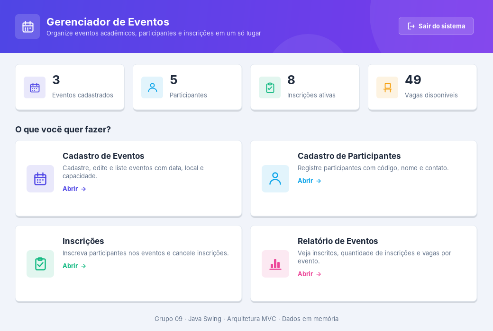
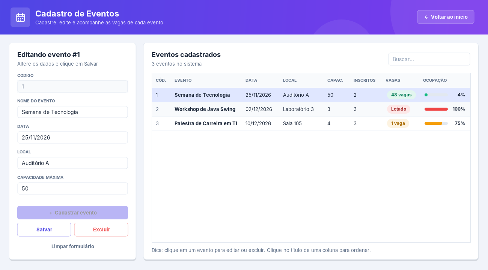
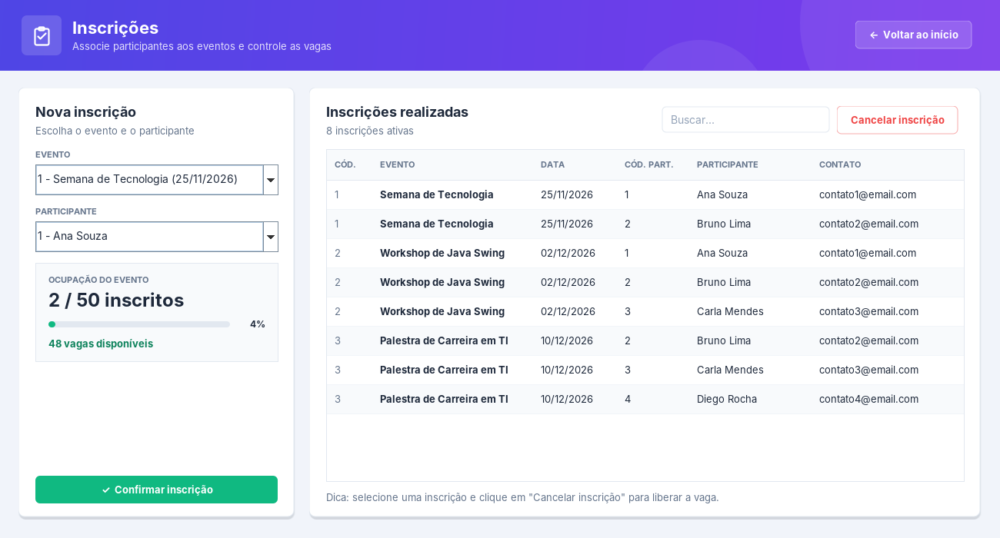
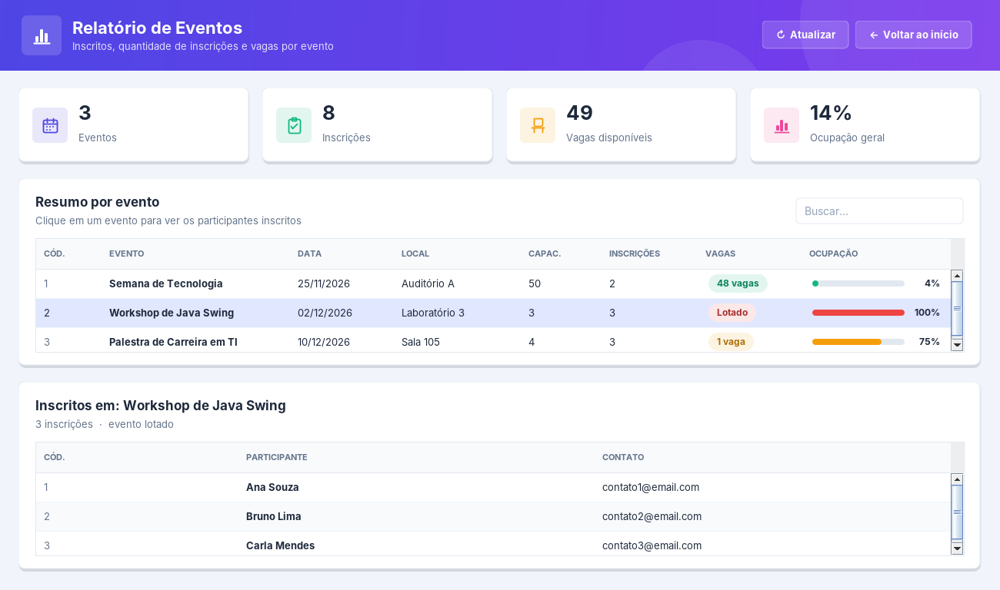

# Sistema de Gerenciamento de Eventos — Grupo 09

Aplicação desktop em **Java SE + Swing**, organizada na arquitetura **MVC**, para organizar eventos acadêmicos, controlar participantes e administrar inscrições. Os dados ficam **em memória** (`ArrayList`) durante toda a execução.

> Atividade prática de **Engenharia de Software — 2º semestre**, disciplina de Iniciação à Programação.
> Grupo **09** — tema: **Gerenciamento de Eventos**.

## Integrantes

- Luan Paulo Verneque
- Renan Alkmim Gama


## Funcionalidades

1. **Cadastro de eventos**: código, nome, data, local e capacidade máxima (cadastrar, atualizar e excluir).
2. **Cadastro de participantes**: código, nome e contato (cadastrar, atualizar e excluir).
3. **Listagem de eventos**: todos os eventos aparecem em uma `JTable`, com inscritos e vagas.
4. **Inscrição de participantes**: escolha o evento e o participante em `JComboBox` e clique em *Inscrever*.
5. **Controle de vagas**: calcula as vagas disponíveis e bloqueia inscrições quando o evento está lotado.
6. **Cancelamento de inscrições**: selecione a inscrição na tabela e cancele; a vaga é liberada.
7. **Relatório de eventos**: para cada evento mostra a quantidade de inscrições, as vagas disponíveis e a lista de participantes inscritos.

## Regras de negócio

| Regra | Onde está implementada |
|---|---|
| Não permitir inscrição duplicada (mesmo participante no mesmo evento) | `Evento.inscrever()` |
| Não permitir inscrição acima da capacidade | `Evento.inscrever()` / `Evento.isLotado()` |
| Não permitir capacidade negativa ou zero | `Evento.setCapacidade()` |
| Não permitir reduzir a capacidade abaixo do número de inscritos | `Evento.setCapacidade()` |
| Não permitir códigos repetidos | `GerenciadorEventos.cadastrarEvento()` / `cadastrarParticipante()` |
| Data válida no formato dd/mm/aaaa | `Evento.setData()` |
| Campos obrigatórios e números válidos | setters do Model e `Conversor.paraInteiro()` |
| Não excluir participante que ainda tem inscrições | `GerenciadorEventos.excluirParticipante()` |

Quando uma regra é violada, o Model lança `RegraNegocioException` e a tela mostra a mensagem com `JOptionPane`.

## Telas

| Tela principal | Cadastro de eventos |
|---|---|
|  |  |
| **Inscrições** | **Relatório** |
|  |  |

## Conceitos de Java aplicados

| Objetivo de aprendizagem | Onde aparece no código |
|---|---|
| Variáveis, operadores e condicionais | validações nos setters de `Evento` e `Participante`; cálculo de vagas em `Evento.getVagasDisponiveis()` |
| Estruturas de repetição | `for` que percorre as listas em `GerenciadorEventos.buscarEvento()` e `getTotalInscricoes()` |
| Classes, objetos e construtores | `Evento`, `Participante`, controllers e telas |
| Arrays e `ArrayList` | listas de eventos, participantes e inscritos (`GerenciadorEventos`, `Evento`) |
| Interface gráfica Swing | pacote `view` (`JFrame`, `JPanel`, `JTextField`, `JButton`, `JTable`, `JComboBox`, `JOptionPane`) |
| Padrão MVC | pacotes `model`, `view` e `controller` |
| Cadastro, consulta, edição, exclusão e processamento | `cadastrar`, `buscar`, `atualizar`, `excluir`, `listar`, inscrições e relatório |
| Regras de negócio e validação de entradas | `Evento.inscrever()`, `Evento.setCapacidade()`, `Conversor.paraInteiro()`, `RegraNegocioException` |

## Estrutura do projeto (MVC)

```
src/
├── Main.java                          → cria Model, Controllers e abre a tela principal
├── model/                             → dados e regras de negócio
│   ├── Evento.java
│   ├── Participante.java
│   ├── GerenciadorEventos.java        → armazenamento em memória (ArrayList)
│   └── RegraNegocioException.java
├── controller/                        → liga a View ao Model
│   ├── EventoController.java
│   ├── ParticipanteController.java
│   ├── InscricaoController.java
│   ├── RelatorioController.java
│   └── Conversor.java                 → converte texto digitado em número
└── view/                              → telas Swing
    ├── Estilo.java                    → cores, fontes, botões, cards e tabelas estilizadas
    ├── Icone.java                     → ícones desenhados com Graphics2D
    ├── TelaPrincipal.java
    ├── TelaSecundaria.java            → base das telas (cabeçalho, voltar e mensagens)
    ├── TelaCadastroEvento.java
    ├── TelaCadastroParticipante.java
    ├── TelaInscricoes.java
    └── TelaRelatorio.java
```

**Fluxo MVC:** o usuário clica em um botão na **View** → a View chama o **Controller** → o Controller converte os dados e chama o **Model** → o Model valida as regras e altera as listas → a View atualiza a `JTable` ou mostra o erro.

Como existe **uma única instância** de `GerenciadorEventos` (criada no `Main` e compartilhada pelos controllers), os dados continuam disponíveis ao fechar e reabrir qualquer janela.

## Interface

O visual moderno foi feito **só com Java Swing** (sem bibliotecas externas): a classe `Estilo` desenha botões arredondados, cards com sombra, cabeçalhos em degradê, campos com dica, tabelas zebradas com busca e ordenação, etiquetas de vagas (verde / amarelo / vermelho "Lotado") e barras de ocupação. Os ícones são desenhados pela classe `Icone` com `Graphics2D`.

- **Tela principal:** números gerais (eventos, participantes, inscrições e vagas) e cards de navegação.
- **Cadastros:** formulário à esquerda e tabela à direita; clique em uma linha para editar ou excluir.
- **Inscrições:** mostra a ocupação do evento escolhido antes de inscrever.
- **Relatório:** totais, resumo por evento e lista de inscritos do evento selecionado.

## Como executar

**Requisito:** JDK 11 ou superior.

### Eclipse
1. *File → Import → General → Existing Projects into Workspace*.
2. Selecione a pasta `SistemaGerenciamentoEventos`.
3. Clique com o botão direito em `src/Main.java` → *Run As → Java Application*.

### NetBeans / IntelliJ
Crie um projeto Java usando a pasta `src` como código-fonte e execute a classe `Main`.

### Terminal
```bash
cd SistemaGerenciamentoEventos
javac -encoding UTF-8 -d bin $(find src -name "*.java")
java -cp bin Main
```
No Windows (PowerShell):
```powershell
javac -encoding UTF-8 -d bin (Get-ChildItem -Recurse src -Filter *.java).FullName
java -cp bin Main
```

## Dados de exemplo

Ao iniciar, o sistema já carrega 3 eventos, 4 participantes e 3 inscrições para facilitar a demonstração (o *Workshop de Java Swing* tem só 3 vagas, bom para mostrar o bloqueio de evento lotado). Para começar vazio, apague a linha `carregarDadosDeExemplo(gerenciador);` no `Main.java`.

## Roteiro sugerido para a apresentação

1. Tela principal e navegação (todas as telas têm *Voltar*).
2. Cadastrar um evento e mostrar na `JTable`; tentar capacidade negativa e data inválida.
3. Cadastrar participante.
4. Inscrever participantes no Workshop até lotar; tentar inscrição duplicada e acima da capacidade.
5. Tentar reduzir a capacidade do Workshop abaixo dos inscritos.
6. Cancelar uma inscrição e mostrar a vaga liberada.
7. Abrir o relatório e clicar em um evento para ver os inscritos.
8. Fechar e reabrir uma tela para mostrar que os dados continuam na memória.

## Tecnologias

Java SE, Java Swing, arquitetura MVC, `ArrayList` e biblioteca padrão do Java. Sem banco de dados e sem frameworks externos.
